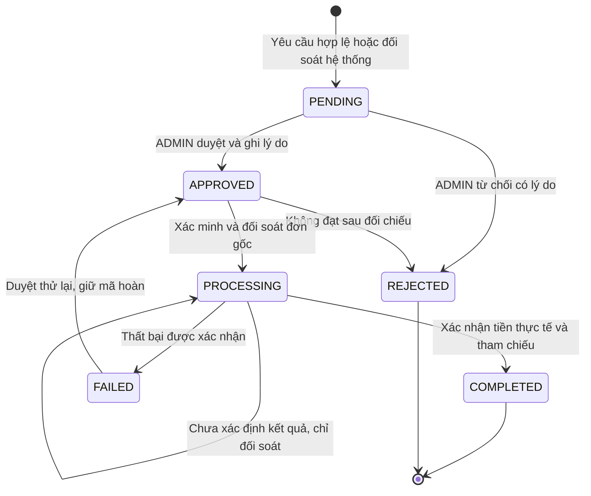

# Hoàn tiền dịch vụ Roomora — 12/10/2026

## Nguyên nhân và phần đã thiếu

API trước chỉ kiểm tra đơn PAID và một yêu cầu duy nhất theo orderId. Không kiểm
tra paidAt hoặc thời gian đã dùng dịch vụ, nên đơn gần ngày thứ bảy vẫn gửi được.
Model cũ chỉ có reason/createdAt; chưa có trạng thái xét duyệt, tài khoản nhận,
bằng chứng, tham chiếu hoàn tiền, audit hoặc màn hình ADMIN.

Giữ nguyên giá gói 49.000đ/7 ngày và các API mua gói. Không gộp hoàn tiền dịch vụ
với thanh toán/công nợ nhà chung.

## Quy tắc 24 giờ

- Mốc là **ServiceOrder.paidAt**: thời điểm backend đã xác thực thanh toán thành
  công và ghi PAID. Không dùng createdAt của đơn, return URL hoặc giờ client.
- USER tạo yêu cầu khi `0 <= serverNow - paidAt <= 86.400.000 ms`. Đúng 24 giờ
  được gửi; vượt một mili giây bị HTTP 409 `REFUND_WINDOW_EXPIRED`.
- `ServiceRefundsService.request` kiểm tra dữ liệu DB dưới row lock, kể cả gọi
  API trực tiếp. Không nhận userId, giá, trạng thái, source hoặc timestamp từ client.
- ADMIN xét tính đúng hạn bằng **createdAt của yêu cầu so với paidAt**, không
  so với giờ đang xử lý. Yêu cầu hợp lệ không tự bị từ chối sau 24 giờ.
- Các yêu cầu cũ ngoài hạn được giữ nguyên lịch sử, không tự xóa/từ chối. ADMIN
  không thể phê duyệt các yêu cầu USER ngoài hạn, nhưng có thể từ chối kèm lý do.
- Tiền nhận muộn/trùng mà không cấp quyền lợi được backend tạo yêu cầu **SYSTEM**.
  Đây là đối soát số tiền không cung cấp dịch vụ, không phải hủy gói sau nhiều ngày.
  USER không thể tự đặt source này; yêu cầu đối soát vẫn cần ADMIN xử lý.
- Timestamp dùng Date/Prisma theo UTC, so sánh epoch milliseconds. Hiển thị UTC+7.
  UI lấy thời gian mẫu từ server và dùng performance.now cho đồng hồ đếm; thay
  đồng hồ máy người dùng không mở thêm quyền hoàn tiền. Backend luôn quyết định cuối.

## State machine



APPROVED chỉ cho bắt đầu xử lý. PROCESSING chưa xác nhận đã hoàn. FAILED là lỗi
chắc chắn; timeout MoMo giữ PROCESSING, không chuyển thành FAILED để gửi tiền lại.
Không có API sửa/xóa yêu cầu đã kết thúc hoặc audit; một giao dịch giữ một yêu cầu
và chỉ hoàn đủ toàn bộ số tiền. Không triển khai hoàn một phần.

## PayOS: chuyển khoản thủ công

Đã kiểm tra [API chính thức payOS](https://payos.vn/docs/api/): có nhận thanh toán,
hủy link và dịch vụ lệnh chi riêng. Không tìm thấy endpoint hoàn link thanh toán
về phương thức gốc trong danh sách này. Tích hợp Roomora đang dùng nhận thanh toán;
chưa kiểm chứng quyền lệnh chi hoặc API xác minh chủ tài khoản. Không dùng hủy link
để đánh dấu hoàn tiền, không tự gọi lệnh chi bằng các khóa hiện có.

1. USER gửi yêu cầu đúng hạn, ADMIN phê duyệt sau đối chiếu giao dịch gốc.
2. Sau duyệt, USER cung cấp/xác nhận ngân hàng, mã ngân hàng, số và tên chủ tài khoản.
   CounterAccount nhận từ webhook **đã xác thực chữ ký** được lưu làm căn cứ.
   Nếu đủ dữ liệu dùng được, điền sẵn thông tin gốc; không tự đánh dấu đã xác minh.
3. ADMIN đối chiếu người yêu cầu/order owner với giao dịch và căn cứ chủ tài khoản.
   Phải nhập ghi chú và tham chiếu chứng từ xác minh. Trùng tên/số không tự chứng
   minh quyền sở hữu. Khi dữ liệu thiếu, ADMIN kiểm tra sao kê/giao dịch ngân hàng
   và chứng từ người dùng theo quy trình thủ công; không tự chuyển tiền.
4. Khác số tài khoản, mã ngân hàng hoặc tên người chuyển gốc cần lý do của USER
   và xác nhận kiểm tra bổ sung của ADMIN. Lưu người kiểm tra, căn cứ và thời điểm.
   USER sửa dữ liệu trước khi xử lý sẽ xóa xác minh hiện tại và tăng version.
5. ADMIN xác nhận giao dịch chưa hoàn/đảo, chuyển PROCESSING rồi thực hiện chuyển
   khoản **bên ngoài Roomora**. Tài khoản nhận được khóa trong lần xử lý này.
6. Tải ảnh chứng từ JPG/PNG/WebP tối đa 5 MB, nhập tham chiếu duy nhất và giờ giao
   dịch có timezone. Backend đối chiếu số tiền **bằng đúng đơn gốc**, proof thuộc
   yêu cầu/lần xử lý hiện tại, trạng thái và phiên bản. ADMIN phải kiểm tra giao
   dịch thực tế, đúng người nhận/số tiền và xác nhận trước khi COMPLETED.
7. Lỗi đã được ngân hàng xác nhận chưa chuyển tiền được ghi FAILED kèm lý do;
   duyệt thử lại có audit, không tạo yêu cầu hoàn mới. Chưa biết kết quả thì giữ
   PROCESSING và đối soát ngân hàng, không thực hiện chuyển khoản mới tùy tiện.

Ảnh được kiểm tra bytes/giải mã/nén, bỏ metadata và lưu riêng trong PostgreSQL.
Đây là bảo vệ định dạng/lưu trữ, **không phải tự động xác minh nội dung ảnh hoặc
tiền đã về**. Trách nhiệm đối chiếu chứng từ với ngân hàng thuộc ADMIN. Không lưu
mật khẩu, OTP hoặc thông tin đăng nhập ngân hàng. Quy trình hiện tại không bắt buộc
hai ADMIN vì project chưa có nhóm quyền tài chính riêng; audit lưu mọi người thao tác.

## MoMo sandbox: về phương thức gốc

Dùng [API refund/query chính thức MoMo](https://developers.momo.vn/v3/docs/payment/api/payment-api/refund/).
Không yêu cầu nhập lại ngân hàng. Adapter chỉ gọi domain test-payment.momo.vn.

- Trước khi gửi lệnh, query thanh toán gốc, kiểm tra merchant, order/transId và
  amount; đối chiếu các khoản refund từ provider, kể cả hoàn bên ngoài Roomora.
- Refund orderId/requestId cố định bằng UUID yêu cầu, khác ID đơn thanh toán;
  HMAC request theo tài liệu. Retry không tạo idempotency key khác.
- Request ký số, kết quả qua HTTPS đến endpoint cố định. Các response refund/query
  trong tài liệu không có contract chữ ký IPN; kiểm tra partner/order/request/amount
  và mã giao dịch, không tự thêm một chữ ký response không được tài liệu quy định.
- Chỉ kết quả thành công xác nhận đúng số tiền mới COMPLETED. Query HTTP 200 hoặc
  resultCode 0 ở vỏ query chưa đủ: cần refundTrans phù hợp, đủ số tiền và mã hoàn.
- Timeout/mismatch giữ PROCESSING với lỗi an toàn và lease; chỉ query mã hiện tại.
  Không giữ DB transaction trong lúc gọi mạng. Partial refund ngoài hệ thống cần
  đối soát, không gửi thêm một lệnh hoàn đủ gây vượt số tiền đã trả.
- Thiếu merchant sandbox giữ yêu cầu APPROVED, API process trả lỗi cấu hình rõ ràng.

## Chống trùng, phân quyền và audit

- Unique orderId của yêu cầu và unique `(method, refundReference)`. Không hoàn một
  phần, amount lấy từ snapshot đơn PAID, không do USER tự chọn.
- Lock theo thứ tự user → listing → order → refund, cộng kiểm tra version cho
  xét duyệt, sửa/xác minh tài khoản, xử lý, proof, hoàn tất và retry.
- Hai ADMIN quyết định/cập nhật cùng version chỉ một thành công. Hai request hoàn
  dùng cùng tham chiếu cho hai chủ đơn khác nhau cũng bị unique DB chặn; trả 409.
- BEGIN/COMPLETE/status + audit + thông báo + refundedAt + dừng boost được ghi
  nhất quán trong transaction tương ứng. Audit lỗi rollback, trả 503 an toàn.
  Nếu provider đã nhận lệnh nhưng DB chưa ghi được kết quả, giữ trạng thái xử lý
  đã claim; đối soát mã hiện tại sau lease, không gửi refund mới.
- `ServiceOrder.status` giữ PAID như lịch sử khoản thu; `refundedAt` chỉ ghi khi
  xác nhận hoàn tất. Không xóa order/boost gốc. Chỉ dừng boost của đơn/đợt đã hoàn,
  không dừng boost thuộc đơn khác hoặc đợt mới. Webhook thu tiền lặp không khôi phục gói.
- Cookie/session AuthGuard và AdminGuard hiện có; OriginGuard chống CSRF cho POST.
  Mỗi action ADMIN kiểm tra lại role/lockedAt ở backend. USER chỉ đọc/nhập tài khoản
  của mình; không tự APPROVED/COMPLETED. Không có endpoint công khai trả ngân hàng.
- Mutation giới hạn USER 20/phút, ADMIN 60/phút/tài khoản/API instance. Map giới hạn
  10.000 tài khoản và dọn bucket hết hạn. Phù hợp backend một instance hiện tại;
  khi nhiều instance cần rate limit dùng chung (Redis hoặc tương đương).
- Audit append ai/thời điểm/trước-sau/lý do/mã hoàn/số tiền/ID proof, lỗi và retry.
  Lịch sử thay đổi tài khoản có bank/name, last4 và fingerprint để phân biệt thay
  đổi, không sao chép số tài khoản đầy đủ vào log thường. Proof và tài khoản đầy đủ
  chỉ dành cho chủ đơn/ADMIN; response dữ liệu tài chính và ảnh `private, no-store`.

## API thêm, giữ API gửi yêu cầu hiện có

Tiền tố `/api/v1`:

| API | Quyền / hành động |
| --- | --- |
| POST `/services/orders/:id/refund-request` | Chủ đơn, reason 10–1000 ký tự, kiểm tra 24 giờ |
| GET `/services/orders/:id/refund` | Chủ đơn, trạng thái và lịch sử |
| POST `/services/orders/:id/refund/recipient` | Chủ đơn, sau duyệt; version và thông tin nhận |
| GET `/services/orders/:id/refund/proofs/:proofId` | Chủ đơn, ảnh riêng tư |
| GET `/admin/refunds?status=PENDING&page=1&limit=10` | ADMIN, lọc và phân trang tối đa 50 |
| GET `/admin/refunds/:id` | ADMIN, đơn gốc, người mua, recipient, proof metadata, audit |
| POST `/admin/refunds/:id/review` | ADMIN, decision APPROVED/REJECTED + note + version |
| POST `/admin/refunds/:id/verify-recipient` | ADMIN, note/evidenceReference, xác nhận bổ sung nếu khác |
| POST `/admin/refunds/:id/process` | ADMIN, đối soát chưa hoàn/đảo; claim PROCESSING |
| POST `/admin/refunds/:id/reconcile` | ADMIN, chỉ query MoMo hiện tại |
| POST `/admin/refunds/:id/proofs` | ADMIN, multipart proof/version, đang xử lý thủ công |
| GET `/admin/refunds/:id/proofs/:proofId` | ADMIN, ảnh riêng tư |
| POST `/admin/refunds/:id/complete` | ADMIN, số tiền khớp, proof/mã/giờ/ghi chú/xác nhận |
| POST `/admin/refunds/:id/fail` | ADMIN, xác nhận chưa chuyển tiền và lý do thất bại |
| POST `/admin/refunds/:id/retry` | ADMIN, duyệt xử lý lại FAILED, giữ mã hoàn |

## Schema, migration và file

Migration `20261012120000_service_refund_workflow` đã deploy PostgreSQL local.
Thêm enum trạng thái/phương thức/source, mở rộng ServiceRefundRequest, thêm
ServiceRefundAction/ServiceRefundProof và dữ liệu người chuyển/refundedAt ở order.
Backfill số tiền/phương thức từ đơn gốc, giữ requests cũ, ghi audit nhập lịch sử;
không xóa dữ liệu hoặc tự giả định đã hoàn tiền. Migration chạy trong transaction.

Máy khác chạy từ backend:

```powershell
npm run prisma:generate
npm run prisma:migrate:deploy
```

| File | Vai trò |
| --- | --- |
| `backend/prisma/schema.prisma` | Refund state, recipient, audit/proof và original payer/refundedAt |
| `backend/prisma/migrations/20261012120000_service_refund_workflow/migration.sql` | DDL, backfill an toàn và unique references |
| `backend/src/modules/billing/refund-rules.service.ts` | Window UTC, locks, audit/transition/completion chung |
| `backend/src/modules/billing/service-refunds.service.ts` | USER request, sở hữu, recipient sau duyệt |
| `backend/src/modules/billing/admin-refunds.service.ts` | ADMIN xét duyệt/xác minh/process/proof/complete/retry/reconcile |
| `backend/src/modules/billing/momo-refunds.service.ts` | Official sandbox query/refund, idempotency, xử lý kết quả chưa rõ |
| `backend/src/modules/billing/refunds.controller.ts` | API USER/ADMIN, guards, private proof và upload hạn chế |
| `backend/src/modules/billing/refund-rate.guard.ts` | Giới hạn mutation theo tài khoản |
| `backend/src/modules/billing/dto/refund.dto.ts` | Whitelist/validation và xác nhận các thao tác tiền |
| `backend/src/modules/billing/billing.module.ts` | Đăng ký refund services/controllers/guards |
| `backend/src/modules/billing/billing.controller.ts` | Giữ route gửi yêu cầu, gọi service có 24h và cache riêng |
| `backend/src/modules/billing/billing-types.ts` | Metadata counterparty đã xác thực của notification |
| `backend/src/modules/billing/payos-gateway.service.ts` | Chỉ nhận thông tin payer sau signature validation |
| `backend/src/modules/billing/service-payments.service.ts` | SYSTEM corrective request/audit trong transaction callback |
| `backend/src/modules/billing/service-orders.service.ts` | Refund deadline/eligibility/server time từ dữ liệu thật |
| `backend/src/modules/billing/service-receipts.service.ts` | PDF ghi nhận kết quả hoàn đã xác nhận, giữ biên nhận thu gốc |
| `backend/src/modules/admin/admin.service.ts` | Số yêu cầu hoàn cần xử lý trên dashboard |
| `backend/.gitignore` | Bỏ qua output build kiểm chứng riêng |
| `frontend/src/lib/billing.ts` | Kiểu/status/lỗi refund và timeout thao tác gateway |
| `frontend/src/lib/admin.ts` | Navigation hoàn tiền |
| `frontend/src/components/admin/admin-workspace.tsx` | Dashboard/menu hoàn tiền, giữ style chung |
| `frontend/src/components/admin/admin-refunds.tsx` | Danh sách, đối chiếu, hành động và audit ADMIN |
| `frontend/src/app/admin/hoan-tien/page.tsx` | Trang ADMIN mới |
| `frontend/src/components/billing/service-refund-panel.tsx` | USER hạn 24h, recipient, trạng thái/kết quả/audit |
| `frontend/src/components/billing/refund-proof.tsx` | Fetch ảnh có cookie, blob riêng, revoke khi đóng |
| `frontend/src/components/billing/service-order-card.tsx` | Tích hợp panel vào lịch sử hiện có |
| `frontend/src/components/billing/services.tsx` | FAQ 24 giờ |
| `frontend/src/app/services.css` | Refund forms/list/proof responsive, dùng theme tokens |
| `backend/test/service-refunds.e2e-spec.ts` | 21 HTTP/PostgreSQL case tài chính/phân quyền/đồng thời |
| `backend/src/modules/billing/refund-rules.service.spec.ts` | Boundary đúng 24h/±1ms, UTC và timestamp thiếu/tương lai |
| `backend/src/modules/billing/refund-rate.guard.spec.ts` | Hạn mức USER/ADMIN, reset cửa sổ |
| `backend/src/modules/billing/momo-refunds.service.spec.ts` | Signature, stable key, unknown/pending, query và external refund |
| `backend/room.todo`, `backend/src/modules/billing/README.md`, `PHASE_9_STATUS.md`, tài liệu này | Hành vi hiện tại, cấu hình và kiểm chứng |

## Kiểm chứng

- 90 unit backend qua. Boundary chính xác 24h, lệch timezone, signature MoMo và
  result query 0 chưa có refund không được coi thành công.
- Toàn bộ 21 file E2E: **298/298 qua**, PostgreSQL thật, chạy tuần tự.
  Sau bổ sung bank prefill/server clock: **89/89** billing + refunds qua.
- HTTP cases có USER khác/guest/ADMIN/CSRF, client time/amount/status/source giả,
  near-day-seven, review sau hạn, old invalid request, source SYSTEM, audit rollback,
  ngân hàng khác, reset verification, pending/rejected/processing sai trạng thái,
  proof giả, exact amount, confirmed-failure/retry và duplicate webhook sau hoàn.
- Đồng thời: một request/audit, một quyết định, một completion, và hai người mua
  dùng một transfer reference chỉ một hoàn tất. Refund đợt cũ không dừng boost đợt mới.
- Backend TypeScript build và production frontend build qua. Lint file backend
  thay đổi không warning/error; ESLint frontend qua. Tám test API helper frontend qua.
- Edge production UI + API riêng + PostgreSQL thật: sáu nhóm USER/ADMIN/manual
  completion/rejection/ownership/PDF/duplicate callback qua; 320/390/768/1366px
  không tràn ngang, không lỗi JavaScript. Proof fetch thực tế chỉ đúng vai trò/owner.
  Fontconfig cảnh báo cache của fixture tạo ảnh, nhưng ảnh test được tạo và tất cả
  browser cases qua; không thay font giao diện để che cảnh báo môi trường.
- Fixture bank transfer/callback/ảnh chứng từ đều **mô phỏng**, không chuyển hoặc
  hoàn tiền thật. Browser proof đóng watermark TEST / NO REAL FUNDS MOVED.
  Dọn fixture theo UUID/user/order riêng sau test, không xóa giao dịch người dùng.

Artifact local: `.verification/refunds-browser-report.json`,
`.verification/refund-*.png`; output TypeScript riêng `backend/.verification/refund-build`.

## Tối ưu thao tác ADMIN — 12/10/2026

- Hiển thị bước hiện tại, mẫu ghi chú theo trạng thái và cho sửa nội dung trước
  khi gửi. Chọn mẫu không gửi quyết định, không tự tích xác nhận; sau mỗi thao tác
  thành công xóa ghi chú để tránh dùng nhầm giữa xét duyệt, xác minh và hoàn tất.
- So sánh ngân hàng/số tài khoản/tên người chuyển gốc với tài khoản khách đề nghị.
  Thiếu dữ liệu hiển thị rõ; thông tin trùng nhau không được coi là xác minh chủ
  tài khoản. Có nút sao chép mã tra cứu, người nhận, số tiền và nội dung chuyển khoản.
- Có thể chọn giao dịch thu tiền gốc đã lưu làm tham chiếu đối chiếu hoặc nhập
  căn cứ khác. ADMIN vẫn xác nhận đã kiểm tra căn cứ chủ tài khoản; xác nhận ở UI
  gắn với version hiện tại, kể cả kiểm tra tài khoản khác/chưa hoàn/thất bại; dữ
  liệu thay đổi thì phải kiểm tra lại. Giữ điều kiện backend về tài khoản khác và audit.
- Ảnh vừa tải được chọn sẵn; chỉ chứng từ thuộc lần PROCESSING hiện tại xuất hiện
  trong lựa chọn hoàn tất. Các yêu cầu còn thiếu hiển thị ngay dưới nút xác nhận.
- Mã giao dịch hoàn tiền và giờ chuyển khoản phải lấy từ chứng từ/ngân hàng thực
  tế. UI và API chặn dùng ID yêu cầu, ID đơn hoặc mã giao dịch thu tiền gốc làm mã
  hoàn tiền. Không tự sinh mã ngân hàng hoặc coi nội dung chuyển khoản là bằng chứng.
- Kiểm chứng bổ sung: 22/22 E2E HTTP/PostgreSQL hoàn tiền qua, gồm chặn mã gốc mà
  không đổi trạng thái/refundedAt/audit hoàn tất. TypeScript và lint qua.
- Edge trên Next dev: chọn/sửa mẫu, sao chép tài khoản, chọn giao dịch đối chiếu,
  xóa xác nhận cũ khi USER đổi version tài khoản, xác nhận kiểm tra,
  tự chọn ảnh mới, chặn mã đơn, hoàn tất với tham chiếu riêng, quyền đọc chứng từ
  và PDF qua. 320/390/768/1366px không tràn ngang, không lỗi JavaScript. Giao dịch
  và chứng từ kiểm thử đều mô phỏng; chưa kiểm chứng thu/hoàn tiền thật.
  Artifact: `.verification/refunds-admin-shortcuts-report.json`.

## Phụ thuộc và giới hạn

MoMo cần merchant sandbox có giao dịch gốc thật để nghiệm thu API refund/query;
mock đã kiểm chứng contract/điều khiển, chưa chứng minh tiền được hoàn trên MoMo thật.
PayOS hiện yêu cầu ADMIN chuyển khoản/đối soát ngân hàng thủ công. Chưa có cấu hình
API xác minh chủ tài khoản hoặc bằng chứng tự động từ ngân hàng; ảnh + attestation
ADMIN không được quảng bá thành xác minh tự động. Hạn mức approval nhiều cấp và
đối soát ngân hàng định kỳ tự động chưa nằm trong kiến trúc hiện tại.
